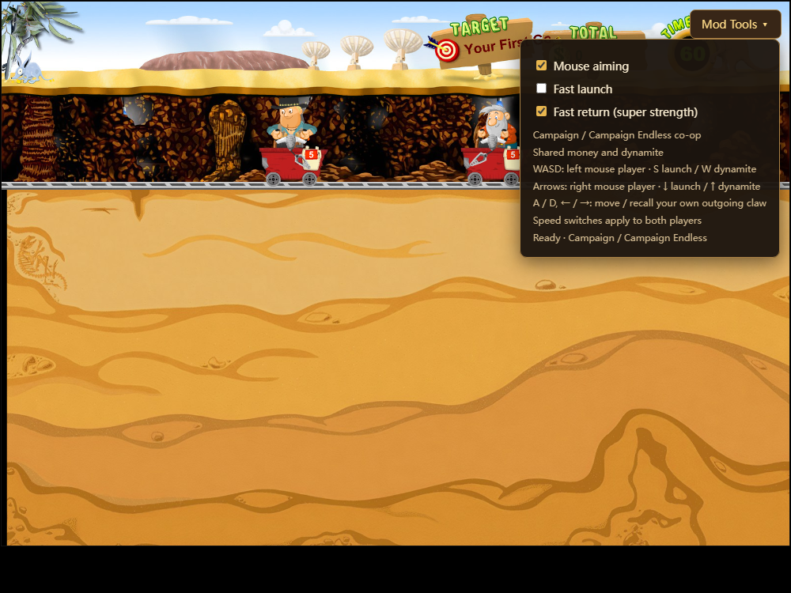

# Gold Miner: Party Rush — Vegas Co-op

Local two-player co-op and optional modifiers for **Arcade → Campaign** and **Campaign Endless** in Gold Miner: Party Rush.

[中文说明](README.zh-CN.md) · [Download the latest release](https://github.com/yuGAN6/gold-miner-vegas-coop/releases/latest) · [Development guide](docs/DEVELOPMENT.md)

## 1. Features

- Modifier panel follows Chinese/English game language; all other languages use English.
- Two independently controlled miners in the Vegas campaign and endless campaign.
- Left/right mouse aiming, fast launch and fast return in a collapsible top-right panel.
- Independent early recall and dynamite, including when fast return is enabled.
- Shared money, target, timer, shop and dynamite inventory.
- Swimming-ring movement, continued co-op across mining scenes, and settlement that waits for both players.

## 2. Screenshot

## 3. Compatibility

| Requirement | Supported version |
| --- | --- |
| Platform | Windows; official Steam installation |
| Game | Gold Miner: Party Rush |
| Steam app / build | `4815320` / `26941259` |
| Game version | `0.6.5` |
| Original file | `resources/vegas/vegas.pack` |
| Original SHA-256 | `82fdc3a1fc61576ab86b571a9d7b8289da3c1a496121c298f7476ab04aed0b9a` |
| Mod version | `0.2.1` |

The installer requires an exact matching original pack. It refuses other builds and other modifications. This project is separate from [Gold Miner Classic Edition co-op](https://github.com/yuGAN6/gold-miner-solo-coop).

## 4. Install and uninstall

1. Download `GoldMiner-Vegas-Coop-v0.2.1.zip` from [Releases](https://github.com/yuGAN6/gold-miner-vegas-coop/releases).
2. Close the game and extract the entire archive.
3. Run `Install.cmd`; select the game folder if asked. Alternatively, drag the folder containing `Gold Miner Party Rush.exe` onto `Install.cmd`.
4. Launch normally from Steam and select **Arcade → Campaign** or **Campaign Endless**.

No Python, Java, Node.js or decompiler is needed to install. Uninstall older/different mods before applying this release. To remove this mod, close the game and run `Uninstall.cmd`. The verified original backup is retained beside the Vegas pack. Saves are not modified.

## 5. Controls

| Action | Left player | Right player |
| --- | --- | --- |
| Move while idle | A / D | ← / → |
| Launch | S | ↓ |
| Aim and launch | Left mouse | Right mouse |
| Recall own outgoing claw early | A / D | ← / → |
| Dynamite on carried cargo | W | ↑ |

Early recall affects only the corresponding player. The modifier panel applies to both players and saves its settings locally. Mouse aiming defaults to on; fast launch and fast return default to off. Aiming accepts points below the rope pivot inside the game stage. Repeated clicks do not redirect an active shot.

## 6. How the patch works

The mod reuses Vegas's native second-player cart, claw and reward components in the campaign mining scenes. It separates physical controls from the shell's synthetic key mapping and shares campaign rewards and inventory. The optional speed controls use intermediate collision checks and the native strength-return behavior.

Only `gmvegas_main.swf` inside the Vegas pack is replaced. The release is a copy/literal delta: unchanged encrypted entries are copied from the player's original installation. The installer reconstructs the tested pack, verifies SHA-256, backs up the original, then replaces it atomically. It does not alter `app.asar`, signed integrity metadata, Steam DLLs or anti-cheat binaries. The repository does not contain the original game, pack decoder or its embedded keys.

## 7. Development

See [DEVELOPMENT.md](docs/DEVELOPMENT.md) for local extraction, building, browser tests and portable package export. Developers need their own matching game installation, Python, Node.js, Java and FFDec. Generated game assets and work files are Git-ignored. Mod scripts are MIT-licensed; original game content remains the property of its owners.

## 8. Validation and limitations

Both native modes were tested with the game's bundled Ruffle and original Vegas page: independent controls and recall, shared rewards, dynamite, swimming rings, speed toggles, numeric countdowns, waiting for both payouts, and all **55 mining scene entries** in each mode. These are automated entry/behavior checks, not a claim of a complete playthrough of every random layout.

The portable installer is tested on isolated copies for installation, repeat installation, restoration, wrong versions, corrupt data and failed final validation. See [validation.json](docs/validation.json). Testing on another physical PC remains unverified. Updates and Steam file verification can remove the patch; do not force this release onto a newer build. The old native Vegas two-player menu is not added by this mod. This is an unofficial project, not an official release or an online multiplayer mod.
