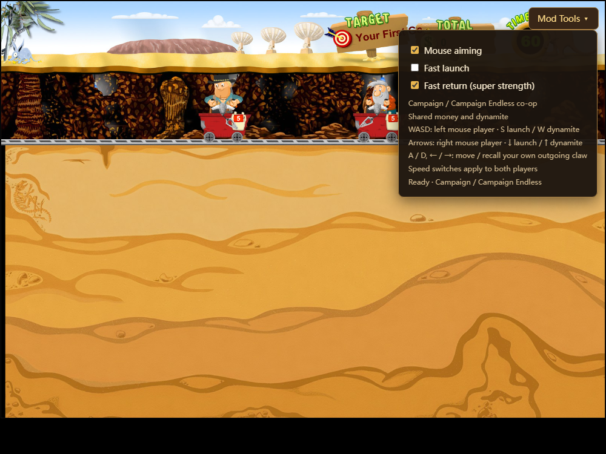

# Gold Miner: Party Rush — Vegas 双人 Mod

为 Gold Miner: Party Rush 的**街机 → 战役模式**和**战役无尽**添加本地双人合作与可选修改功能。

[English](README.md) · [下载最新版本](https://github.com/yuGAN6/gold-miner-vegas-coop/releases/latest) · [开发指南](docs/DEVELOPMENT.md)

## 1. 功能

- 修改栏随游戏语言切换中文／英文，其他语言默认英文。
- Vegas 剧情战役和战役无尽中加入两名独立控制的矿工。
- 右上角折叠修改栏：左右鼠标定向、快速出钩、加速回收。
- 独立提前回收和炸药操作，支持开启加速回收时使用炸药。
- 共享金额、目标、时间、商店和炸药库存。
- 游泳圈移动、换关后保持双人、结算等待两名玩家完成回收。

## 2. 截图

## 3. 兼容性

| 要求 | 内容 |
| --- | --- |
| 平台 | Windows，使用系统自带 PowerShell |
| 资源 | Gold Miner Vegas Flash 资源 |
| 原始文件 | `resources/vegas/vegas.pack` |
| 原包 SHA-256 | `82fdc3a1fc61576ab86b571a9d7b8289da3c1a496121c298f7476ab04aed0b9a` |
| Mod 版本 | `0.2.3` |

安装器不以 Steam app、build、游戏版本字符串或游戏 EXE 名称作为兼容条件。保留的 SHA-256 是资源内容前提：固定偏移差分必须读取预期的原始字节。无关文件或 Steam 元信息变化不影响安装；Vegas 包内容改变则需要匹配的新差分。这是独立于[黄金矿工经典版双人 Mod](https://github.com/yuGAN6/gold-miner-solo-coop) 的项目。

## 4. 安装与卸载

1. 从 [Releases](https://github.com/yuGAN6/gold-miner-vegas-coop/releases) 下载 `GoldMiner-Vegas-Coop-v0.2.3.zip`。
2. 关闭游戏，完整解压压缩包。
3. 运行 `Install.cmd`，必要时选择游戏文件夹。也可以把包含 `resources/vegas/vegas.pack` 的文件夹拖到 `Install.cmd` 上。
4. 照常启动游戏，选择**街机 → 战役模式**或**战役无尽**。

安装不需要 Python、Java、Node.js 或反编译工具。安装前请卸载旧版或其他 Mod。关闭游戏后运行 `Uninstall.cmd` 可卸载；经过校验的原始备份保留在 Vegas 包旁边。不修改存档。

## 5. 操作

| 动作 | 左侧玩家 | 右侧玩家 |
| --- | --- | --- |
| 待机时移动 | A / D | ← / → |
| 出钩 | S | ↓ |
| 定向并出钩 | 鼠标左键 | 鼠标右键 |
| 提前回收自己的伸出钩子 | A / D | ← / → |
| 炸掉钩上物品 | W | ↑ |

提前回收只影响所属玩家。修改栏对两人同时生效，并在本机保存设置。鼠标定向默认开启，快速出钩和加速回收默认关闭。瞄准接受画面内绳索支点下方的位置；重复点击不会改变正在进行的抓取方向。

## 6. 补丁原理

Mod 将 Vegas 原生第二人的矿车、抓钩和奖励组件接入战役采矿场景，区分真实按键与外层合成按键，并共享战役收益和库存。加速功能采用中间位置碰撞检查和原生力量回收逻辑。

只替换 Vegas 包内的 `gmvegas_main.swf`。发布包使用复制／新增数据组成的差分补丁，未修改的加密资源从玩家自己的原包复制。安装器重建测试通过的完整包，校验 SHA-256、备份原包后再原子替换。不修改 `app.asar`、签名清单、Steam DLL 或反作弊程序。仓库不包含原游戏、资源包解码器或其内置密钥。

## 7. 开发

本地提取、构建、浏览器测试和便携包导出见 [DEVELOPMENT.md](docs/DEVELOPMENT.md)。开发需要自行持有内容匹配的 Vegas 资源包，以及 Python、Node.js、Java 和 FFDec。生成的游戏资源和工作文件被 Git 忽略。Mod 脚本采用 MIT 许可，原游戏内容仍属于原权利人。

## 8. 验证与限制

已使用游戏内置 Ruffle 和原版 Vegas 页面分别测试两种模式：独立操作和提前回收、共享收益、炸药、游泳圈、速度开关、正常倒计时、等待两人结算，以及每种模式的全部 **55 个采矿场景入口**。这是入口及行为自动化检查，不代表完整通关所有随机布局。

便携安装器在隔离副本中验证安装、重复安装、恢复、内容不匹配、损坏数据和最终校验失败，见 [validation.json](docs/validation.json)。尚未在另一台实体电脑上验证。游戏更新和 Steam 文件验证可能覆盖补丁，Vegas 包内容改变时需要匹配的新差分，与显示的游戏版本无关。此 Mod 不添加旧 Vegas 原生双人菜单。这是非官方项目，并非官方发行版或在线多人 Mod。
